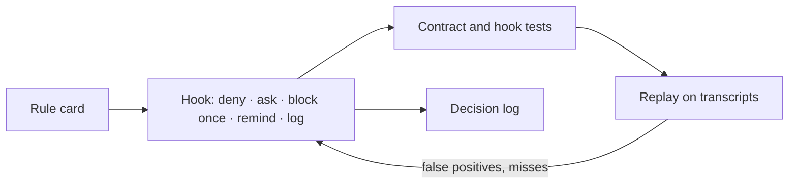

# rules-as-code-harness

[](LICENSE)


Rules for AI coding agents that are enforced, tested and measured — not just written down.

Most agent rule files are prose the model may or may not follow. rules-as-code-harness treats each rule like code: a short **rule card**, a **hook** that enforces the part a machine can check, a **contract test** that keeps the card and the hook in sync, and **offline replay** of session transcripts to tune false positives. One tool-neutral source feeds Claude Code, Codex and other agents.

## Features

- **Scene-rule gate** — denies the first tool call that needs a rule the agent has not read (git, tests, browser, MCP, structured writes, project edits).
- **Secret protection** — blocks raw reads of `.env`, keys and credential files (including paths built from variables) and secrets in outbound commands or URLs.
- **Read whitelist** — asks before reading outside configured roots, judged by real path (symlinks, junctions, short names).
- **Stale-claim check** — blocks "all tests pass" when files changed after that check last ran.
- **Source labels** — after a web search, every cited source needs a grade and a read mode.
- **Reuse gate** — no plan or new project before a search for existing solutions.
- **Dangerous commands** — force push, hard reset, publish and deploy need confirmation.
- **Subagent-aware** — safety checks apply to subagents too; process gates stay with the parent.
- **One source, many agents** — `sync` generates each tool's entry file with backups, a SHA-256 manifest and restore.
- **Per-check switches** — every check is `off`, `warn` or `enforce` in one config file.

## How it works



| Hook | Does |
| --- | --- |
| `SessionStart` | Records a git baseline for line counting; re-injects core rules after compaction |
| `UserPromptSubmit` | Adds the date, the current model tier and topic-specific reminders (≤ 600 chars) |
| `PreToolUse` | Secret, egress and banned-tool denies; dangerous-command asks; scene-rule, reuse and skill-script gates; read whitelist |
| `PostToolUse` | Nudges when a scene rule was not read (Claude Code) |
| `Stop` | Source labels and stale pass claims (block once); review and update-log reminders |

Hooks that cannot read the transcript fail open; the security checks fail closed.

## Quick start

Requires Node.js 20+ and git. Clone into a path without spaces.

```bash
git clone https://github.com/a1989524/rules-as-code-harness ~/.agents/prompts
cd ~/.agents/prompts
node --test tests/*.test.mjs                          # run the test suite
node tools/register-hooks.mjs --host claude --dry-run # preview hook registration
node tools/register-hooks.mjs --host claude           # register (backs up settings.json first)
node tools/sync.mjs --dry-run                         # preview generated entry files
node tools/sync.mjs                                   # write them (with backups)
```

Use `--host codex` for Codex. Roll back a sync with `node tools/sync.mjs --restore <backup-dir>`.

## Configuration

Everything lives in `adapters.json`:

| Key | Purpose |
| --- | --- |
| `targets` | Entry files to generate per tool (`import`, `copy` or `dir` mode) |
| `hooks.enforce` | Per-check level: `off`, `warn` or `enforce` |
| `hooks.readAllow` | Read-whitelist roots |
| `hooks.bannedTool` | A tool that must never be called (name, tool/URL/command patterns) |
| `hooks.dangerousCommandPatterns` | Commands that need confirmation |
| `hooks.*Keywords` | Prompt classification for reminders |
| `lint` | Neutral-wording deny list and size budgets for the cards |

Set `AGENT_PROMPTS_HOOKS=off` to disable all hooks for one session.

## Writing rules

Rules are short cards in `rules/`, routed from `INDEX.md`. Must-use cards ship in every entry file; scene cards are read on demand, and the hooks gate the actions that need them. Each card ends with an **Enforced by** line, and `tests/rules-contract.test.mjs` checks that the examples on the card pass the very check that enforces it.

```bash
node tools/lint.mjs   # neutral wording, size budgets, routing coverage, duplicate sentences
```

## Evals

- `evals/replay.mjs` — rebuild a session transcript up to a moment and rerun the hooks offline (no model calls).
- `evals/run.mjs` — live smoke cases through a real CLI, graded by code (uses API credits).

See [evals/smoke.md](evals/smoke.md).

## Project structure

```
core.md, INDEX.md, rules/   tool-neutral rule cards
profiles/                   mapping to Claude Code and Codex
agents/                     example subagent roles
hooks/                      the five hooks and their shared library
tools/                      sync, register-hooks, lint, delegation report
tests/                      node:test suites
evals/                      replay and smoke cases
docs/                       design notes
adapters.json               configuration
```

## License

[MIT](LICENSE)
